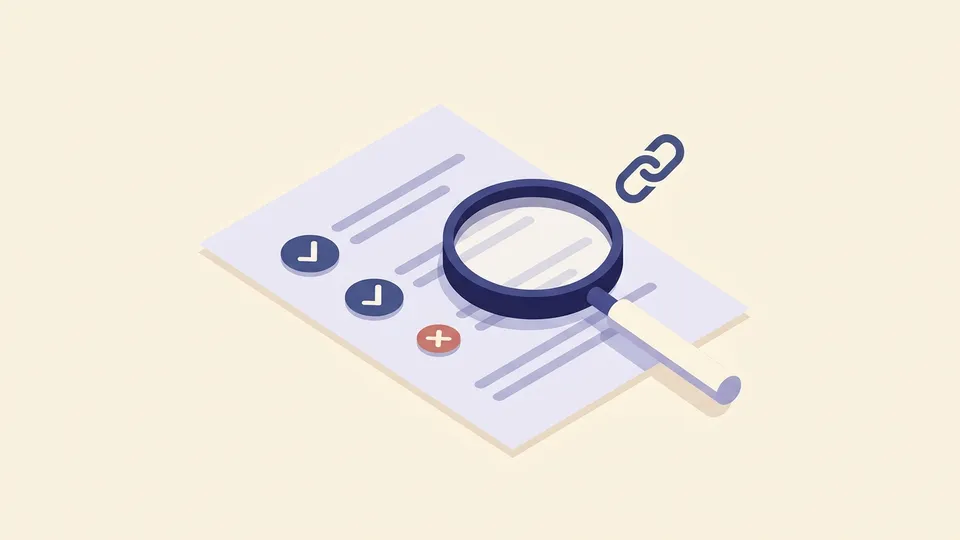
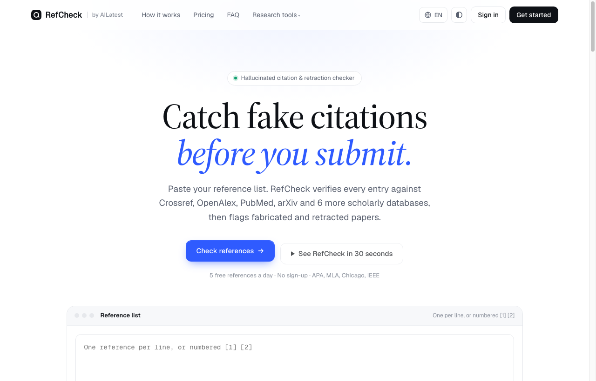

  <b>English</b> | <a href="#chinese"><b>中文说明</b></a>

# RefCheck (文献侦探) · Hallucinated Citation & Retraction Checker 🔍

  <b>Catch fake, fabricated, or retracted citations before you submit your academic paper.</b> 
  投稿前一键核对参考文献真伪。对照 Crossref、OpenAlex、PubMed 与 Retraction Watch 等权威公开数据库，秒级排查虚构文献与撤稿风险。

  
  
  
  

---

## 🖼 Visual Showcase

### 1. Official Cover Art

  

### 2. Live Application Interface

  

<em>Live screenshot captured from production: <a href="https://refcheck.ailatest.org/">refcheck.ailatest.org</a>.</em>

---

## 🌟 Key Features

1. **AI Hallucination Detection**: LLMs frequently invent realistic-sounding paper titles, fictitious author teams, and nonexistent DOIs. RefCheck cross-examines every reference against authoritative databases to expose non-existent records.
2. **Retraction Watch Integration**: Directly flags papers that have been officially retracted, placed under Expression of Concern, or issued major errata notices.
3. **9+ Authoritative Database Connectors**:
   - Scholarly Metadata: **Crossref**, **OpenAlex**, **PubMed**, **Europe PMC**, **Semantic Scholar**, **arXiv**, **DBLP**, **DataCite**.
   - Books & Monographs: **Open Library**, **Google Books**.
   - Open Access Verification: **Unpaywall**.
4. **Smart Title & Metadata Correction**: For references containing typos in author names, inverted volume/page numbers, or missing DOIs, RefCheck suggests verified standard records.
5. **Multi-Format Bibliography Formatting**: One-click standardized output formatted in **GB/T 7714-2015**, **APA 7th**, **MLA 9th**, **Chicago 17th**, and **IEEE**.
6. **Zero-Barrier Trial**: Inspect 5 citations daily without signing up or logging in.

---

  <a href="#top"><b>Back to Top (English)</b></a> | <b>中文说明</b>

## 🇨🇳 中文介绍 · RefCheck (文献侦探)

### 为什么需要文献侦探？
随着大模型辅助科研写作的普及，**AI 虚构参考文献（Hallucinated Citations）**已成为学术论文投稿被秒拒甚至遭遇学术不端调查的主要原因之一：
- AI 生成的论文题目高度逼真，但 DOI 根本不存在或对应完全无关的文章；
- 引用的文献在发表后已被官方**撤稿（Retracted）**或标记预警，作者未曾察觉；
- 参考文献的卷期、页码、年份存在细微笔误，导致审稿人检索失败。

### 核心功能与核查维度
1. **核查全网真实题录**：逐条比对 Crossref、OpenAlex、PubMed、Europe PMC、Semantic Scholar、arXiv、DBLP 与 DataCite 真实元数据。
2. **权威撤稿数据筛查**：深度整合 Retraction Watch 数据库，醒目标记撤稿论文、关注声明（Expression of Concern）与更正记录。
3. **更正题录与补齐缺失**：自动找回缺失的官方 DOI，纠正错位作者与拼写笔误。
4. **一键规范化导出**：支持输出 GB/T 7714、APA、MLA、Chicago 与 IEEE 标准格式。
5. **无需注册即可体验**：免登录每日免费核查 5 条参考文献。

🌐 **立即在线体验**：[**https://refcheck.ailatest.org/**](https://refcheck.ailatest.org/)
